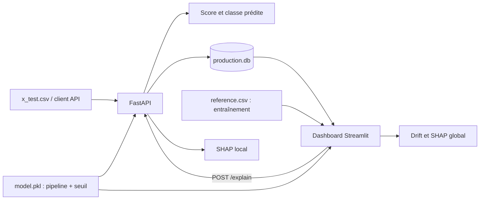

# P8 — Credit Scoring & MLOps

**Prédire le risque de crédit, suivre les prédictions et expliquer les décisions du modèle.**

Ce projet expose un modèle LightGBM à travers une API FastAPI et propose un dashboard Streamlit pour suivre son utilisation. Il réunit l’inférence, la journalisation SQLite, la détection de dérive des données et l’explicabilité SHAP, avec des tests automatisés et une image Docker.

Projet réalisé dans le cadre du parcours OpenClassrooms — Projet 8.

| Composant | Rôle |
|---|---|
| **FastAPI** | Valider les données client, calculer les scores et fournir les explications locales |
| **SMOTE + LightGBM** | Pipeline de classification avec seuil métier sauvegardé |
| **SQLite** | Conserver les requêtes de prédiction et leurs résultats |
| **Streamlit + Plotly** | Explorer les scores, les classes et les latences |
| **Evidently** | Comparer les données de référence aux données de production |
| **SHAP** | Expliquer le modèle globalement et pour un client |
| **Pytest · GitHub Actions · Docker** | Tester l’application et construire son image |

## Sommaire

- [Démarrage rapide](#démarrage-rapide)
- [Architecture](#architecture)
- [Données et modèle](#données-et-modèle)
- [API et exemples](#api-et-exemples)
- [Dashboard de monitoring](#dashboard-de-monitoring)
- [Explicabilité SHAP](#explicabilité-shap)
- [Tests et intégration continue](#tests-et-intégration-continue)
- [Exécution avec Docker](#exécution-avec-docker)
- [Actualisation et dépannage](#actualisation-et-dépannage)

## Démarrage rapide

### Prérequis

- Python **3.12**, version utilisée en CI et dans Docker ;
- `uv` pour installer les dépendances et exécuter les commandes ;
- Docker si vous souhaitez lancer l’API dans un conteneur.

Les commandes suivantes s’exécutent depuis la racine du projet.

### 1. Installer le projet et lancer l’API

```bash
git clone https://github.com/PaulLARRIBET/P8.git
cd P8
uv sync --frozen
uv run uvicorn app.main:app --app-dir src --reload
```

Les fichiers `model/model.pkl`, `data/reference.csv` et `data/x_test.csv` doivent être présents pour utiliser l’ensemble de la démonstration.

| Service | Adresse locale |
|---|---|
| API | http://127.0.0.1:8000 |
| Documentation Swagger | http://127.0.0.1:8000/docs |
| Vérification de disponibilité | http://127.0.0.1:8000/health |

### 2. Générer les données de production

Dans un deuxième terminal :

```bash
uv run python src/app/send_x_test_to_api.py
```

Le script envoie les lignes de `data/x_test.csv` à `/predict`, une par une. Il affiche le nombre de succès et d’erreurs. Chaque prédiction réussie est enregistrée dans `data/production.db`, créée automatiquement au démarrage de l’API.

**Chaque nouvelle exécution ajoute des prédictions à l’historique**, y compris pour les clients déjà présents.

### 3. Ouvrir le dashboard

Dans un troisième terminal :

```bash
uv run streamlit run monitoring/dashboard.py
```

Le dashboard est généralement accessible à l’adresse http://localhost:8501. L’API doit rester disponible pour obtenir les explications locales. Une base initialisée contenant au moins une prédiction est nécessaire pour afficher le dashboard complet.

## Architecture



```text
P8/
├── .github/workflows/ci.yml      # Tests puis construction Docker
├── data/
│   ├── reference.csv             # Données d’entraînement de référence
│   ├── x_test.csv                # Données de simulation de production
│   └── production.db             # Historique local généré, ignoré par Git
├── model/
│   └── model.pkl                # Pipeline entraîné et seuil métier
├── monitoring/
│   └── dashboard.py             # Interface Streamlit
├── src/app/
│   ├── __init__.py
│   ├── main.py                  # Routes FastAPI et validation des entrées
│   ├── model.py                 # Inférence et explications SHAP locales
│   ├── monitoring.py            # Initialisation et écriture SQLite
│   └── send_x_test_to_api.py     # Simulation de requêtes client
├── tests/
│   ├── first_row.json           # Cas de référence et résultats attendus
│   ├── test_api.py
│   └── test_model.py
├── model.py                     # Script d’inspection de l’artefact
├── Dockerfile
├── .dockerignore
├── .gitignore
├── .python-version
├── pyproject.toml               # Dépendances et configuration Pytest
├── uv.lock                      # Versions verrouillées
└── README.md
```

## Données et modèle

### Jeux de données

| Fichier | Contenu actuel | Usage |
|---|---|---|
| `data/reference.csv` | 10 000 lignes, 20 variables et `SK_ID_CURR` | Référence issue de l’entraînement, drift et SHAP global |
| `data/x_test.csv` | 10 000 lignes, 20 variables et `SK_ID_CURR` | Simulation de clients en production |
| `data/production.db` | Historique alimenté par l’API | Monitoring et sélection des clients |

Les CSV contiennent des variables déjà préparées. Le code d’inférence attend ces agrégats directement : il ne reconstruit pas les variables à partir des données brutes de crédit.

`SK_ID_CURR` identifie le client et **n’est jamais envoyé au modèle comme variable prédictive**.

### Pipeline de classification

L’artefact `model/model.pkl`, chargé avec Joblib, contient :

```python
artifact = {
    "model": pipeline,       # Pipeline imbalanced-learn : SMOTE puis LightGBM
    "threshold": 0.508,      # Seuil de l’artefact actuellement fourni
}
```

SMOTE intervient pendant l’entraînement. Lors de l’inférence, le pipeline utilise le classifieur LightGBM sans générer de nouvelles observations.

Le modèle fourni comporte **19 arbres**, une profondeur maximale de **3** et un taux d’apprentissage d’environ **0,044**. Le dépôt fournit le modèle entraîné ; il ne contient pas actuellement de procédure complète pour reproduire son entraînement et son optimisation.

### Variables utilisées

L’ordre des colonnes est reconstruit à partir de `model.feature_names_in_` avant la prédiction.

```text
APPROVED_APP_CREDIT_PERC_VAR
CC_AMT_DRAWINGS_POS_CURRENT_SUM
CC_AMT_DRAWINGS_POS_CURRENT_MAX
CC_AMT_PAYMENT_CURRENT_SUM
CC_AMT_PAYMENT_TOTAL_CURRENT_SUM
CC_AMT_PAYMENT_TOTAL_CURRENT_MEAN
CC_AMT_PAYMENT_TOTAL_CURRENT_MAX
CC_AMT_PAYMENT_TOTAL_CURRENT_MIN
CC_AMT_DRAWINGS_POS_CURRENT_MEAN
CC_AMT_PAYMENT_CURRENT_MEAN
CC_AMT_PAYMENT_CURRENT_MAX
CC_AMT_PAYMENT_CURRENT_MIN
CLOSED_DAYS_CREDIT_ENDDATE_MIN
CC_AMT_DRAWINGS_CURRENT_MAX
CC_AMT_DRAWINGS_CURRENT_SUM
CC_AMT_DRAWINGS_CURRENT_MEAN
CC_AMT_DRAWINGS_POS_CURRENT_MIN
CC_AMT_DRAWINGS_CURRENT_MIN
CLOSED_DAYS_CREDIT_MEAN
EXT_SOURCE_3
```

### Score et seuil métier

```python
probability = model.predict_proba(X)[0, 1]
prediction = int(probability >= threshold)
```

La classe **1** représente le risque de défaut ; la classe **0** correspond à un score inférieur au seuil. Le seuil actuellement enregistré est **0,508**. Le code utilise toujours la valeur contenue dans l’artefact, sans la fixer dans le calcul de prédiction.

La démarche métier décrite dans le projet repose sur le coût `10 × FN + FP`, où un faux négatif est considéré comme dix fois plus coûteux qu’un faux positif. Le calcul d’optimisation de ce seuil n’est pas exécuté par l’API.

Le taux de classe 1 affiché dans le dashboard est la proportion de décisions positives enregistrées. Il ne mesure ni la précision du modèle, ni le taux réel de défaut. Les scores retournés ne sont pas accompagnés d’une étape de calibration dans le code fourni.

## API et exemples

### Routes disponibles

| Méthode | Route | Réponse et effet |
|---|---|---|
| `GET` | `/` | Message d’accueil |
| `GET` | `/health` | `{"status": "ok"}` |
| `POST` | `/predict` | Score, classe, seuil et latence ; enregistrement SQLite |
| `POST` | `/explain` | Explication SHAP locale ; aucun ajout à l’historique des prédictions |

Les deux routes `POST` utilisent le même schéma de données client. Pydantic vérifie notamment que l’identifiant est positif, que `EXT_SOURCE_3` est compris entre 0 et 1, que les montants et la variance sont positifs ou nuls, et que `CLOSED_DAYS_CREDIT_MEAN` est négatif ou nul. Une entrée ne respectant pas le schéma renvoie une erreur **422**.

### Tester une prédiction

Le fichier `tests/first_row.json` contient un client complet ainsi que les résultats attendus. Pour envoyer uniquement ses caractéristiques :

```bash
uv run python - <<'PY'
import json
from pathlib import Path
import requests

client = json.loads(Path("tests/first_row.json").read_text())["features"]
response = requests.post("http://127.0.0.1:8000/predict", json=client, timeout=10)
response.raise_for_status()
print(json.dumps(response.json(), indent=2))
PY
```

Réponse pour le modèle fourni, avec une latence illustrative :

```json
{
  "SK_ID_CURR": 100001,
  "probability": 0.5865516664193919,
  "prediction": 1,
  "threshold": 0.508,
  "latency_ms": 2.5
}
```

La latence mesurée couvre la préparation et le calcul de la prédiction. Elle exclut l’écriture SQLite, le transport réseau et le calcul SHAP.

### Demander une explication locale

Envoyer les mêmes caractéristiques à `POST /explain`. La réponse contient :

| Champ | Description |
|---|---|
| `SK_ID_CURR` | Identifiant client |
| `base_value` | Valeur de base de l’explication SHAP |
| `feature_names` | Noms des 20 variables |
| `feature_values` | Valeurs des variables pour ce client |
| `shap_values` | Contributions dans le même ordre |
| `local_feature_importance` | Variables triées par valeur absolue de leur contribution |

Chaque importance locale comporte `feature`, `value`, `shap_value` et `importance`. Le calcul SHAP est séparé de `/predict` pour ne pas l’effectuer à chaque demande de score.

## Dashboard de monitoring

### Activité et scores

Le dashboard affiche le nombre de prédictions, la proportion de classe 1, la latence moyenne et le percentile 95 de latence. Des graphiques présentent la distribution des scores, la répartition des classes, l’évolution des scores dans le temps et la distribution des latences.

Les indicateurs portent sur **tout l’historique enregistré**, sans filtre de période. Un client envoyé plusieurs fois contribue donc plusieurs fois aux statistiques.

### Dérive des données

Evidently compare les variables communes entre `reference.csv` et les données de production, en excluant `SK_ID_CURR`.

L’interface présente le nombre de variables analysées, la proportion de variables présentant une dérive, ainsi que le test, le score et le seuil statistique utilisés pour chacune. Un sélecteur permet aussi de superposer les distributions d’une variable dans les deux jeux de données.

Les tests sont sélectionnés par `DataDriftPreset` : il ne s’agit pas d’un test unique fixé pour toutes les variables. Une dérive signale une différence de distribution ; elle ne démontre pas à elle seule une dégradation des performances prédictives.

### Historique SQLite

Chaque appel réussi à `/predict` ajoute une ligne dans la table `predictions` :

| Colonne | Contenu |
|---|---|
| `id` | Identifiant interne de la prédiction |
| `timestamp` | Horodatage UTC |
| `features` | Données client sérialisées en JSON, identifiant compris |
| `probability` | Score de classe 1 |
| `prediction` | Classe calculée au moment de la requête |
| `latency_ms` | Temps de calcul mesuré par l’API |

La base ne conserve actuellement ni la version du modèle ni le seuil utilisé pour chaque ligne. Remplacer le modèle ou son seuil ne recalcule pas les décisions historiques.

## Explicabilité SHAP

### Explicabilité globale — données d’entraînement

La section globale utilise **toutes les lignes disponibles dans `data/reference.csv`**, soit 10 000 lignes dans le fichier fourni. Elle explique le modèle actuel sur ces données de référence.

Deux représentations sont proposées :

- **Importance globale** : moyenne des valeurs absolues SHAP pour chaque variable ;
- **Sens et dispersion des contributions** : graphique de synthèse montrant les contributions individuelles et leur relation avec les valeurs des variables.

Le calcul est réalisé directement dans le dashboard à partir de `model.pkl`, puis mis en cache. La date de modification du modèle participe à l’invalidation de ce cache.

### Explicabilité locale — client sélectionné

Le menu **ID_Client** permet de sélectionner un client ou de taper son identifiant pour le rechercher parmi les clients présents en production. En cas de plusieurs prédictions pour un même client, la plus récente est retenue.

L’interface affiche son score et sa classe enregistrés. Le bouton **Afficher l’explication SHAP** appelle ensuite `/explain` avec les caractéristiques de ce client pour afficher les dix variables les plus influentes et un graphique **waterfall**.

### Lire les contributions

Les explications sont calculées sur le LightGBM et exprimées en **log-odds** :

- une contribution positive augmente le score de classe 1 ;
- une contribution négative le diminue ;
- la valeur de base et la somme des contributions reconstruisent le score brut, avant sa transformation en probabilité.

Dans le graphique global, le rouge correspond à une valeur élevée de la variable et le bleu à une valeur faible. Les contributions expliquent le comportement du modèle ; elles n’établissent pas une relation causale.

## Tests et intégration continue

### Exécuter les tests

```bash
uv run pytest -v
```

Les tests couvrent la disponibilité de l’API, les prédictions du modèle et de l’API par rapport au cas de référence, le seuil et la classe attendus, le rejet de certaines données invalides, ainsi que la structure des explications locales.

`tests/first_row.json` doit rester cohérent avec l’artefact livré : après un changement de modèle ou de seuil, les valeurs attendues doivent être revérifiées.

Les tests de `/predict` journalisent également leurs requêtes dans la base configurée par l’application, actuellement `data/production.db`.

### Pipeline GitHub Actions

Le workflow [`.github/workflows/ci.yml`](.github/workflows/ci.yml) est déclenché sur les push vers `main` et les pull requests ciblant `main`.

```text
Checkout → Python 3.12 → Installation uv → uv sync --frozen → Pytest
                                                               ↓
                                                    Construction Docker
```

Le job Docker dépend du succès des tests. Il construit l’image ; le workflow ne publie pas d’image et ne déploie pas l’application.

## Exécution avec Docker

### Construire l’image de l’API

```bash
docker build -t p8-credit-api .
```

L’image utilise Python 3.12 Slim, installe `libgomp1` pour LightGBM et les dépendances verrouillées sans les dépendances de développement. Elle embarque le code de l’API et le modèle.

### Lancer l’API avec une base partagée

```bash
docker run --rm \
  -p 8000:8000 \
  --mount "type=bind,source=$(pwd)/data,target=/app/data" \
  p8-credit-api
```

Le montage conserve la base sur la machine hôte et permet au dashboard lancé localement de lire les prédictions du conteneur. Le dashboard et les CSV ne sont pas inclus dans l’image actuelle.

Sans montage, la base reste dans le conteneur et est perdue lorsque celui-ci est supprimé. L’API et sa documentation restent accessibles aux mêmes adresses locales que lors d’une exécution sans Docker.

## Actualisation et dépannage

| Situation | Explication et action |
|---|---|
| Le dashboard ne reflète pas les dernières requêtes | Les données sont mises en cache avec `st.cache_data`. Utiliser **⋮ → Clear cache**, puis relancer l’affichage. |
| Le modèle ou le seuil a été remplacé | Redémarrer l’API pour recharger `model.pkl`. Les anciennes lignes SQLite conservent leurs résultats d’origine. |
| Le taux de classe 1 paraît inattendu | Il représente les classes enregistrées sur tout l’historique. Vérifier le seuil réellement chargé, les scores et les éventuelles simulations répétées. |
| L’explication locale échoue | Vérifier que l’API est disponible à `http://127.0.0.1:8000` et que les caractéristiques du client respectent son schéma. |
| Aucun historique n’est disponible | Démarrer l’API puis envoyer une prédiction ou lancer le script de simulation avant d’utiliser le dashboard. |
| Le fichier de référence a changé | Vider le cache Streamlit pour recharger le CSV et recalculer les résultats associés. |

L’explication locale utilise le modèle actuellement chargé dans l’API, tandis que le score affiché provient de l’historique. Pour comparer ces éléments, conserver la même version du modèle pour la génération des prédictions et leur explication.

## Auteur

**Paul Larribet** — Projet OpenClassrooms P8  
[Dépôt GitHub](https://github.com/PaulLARRIBET/P8)
